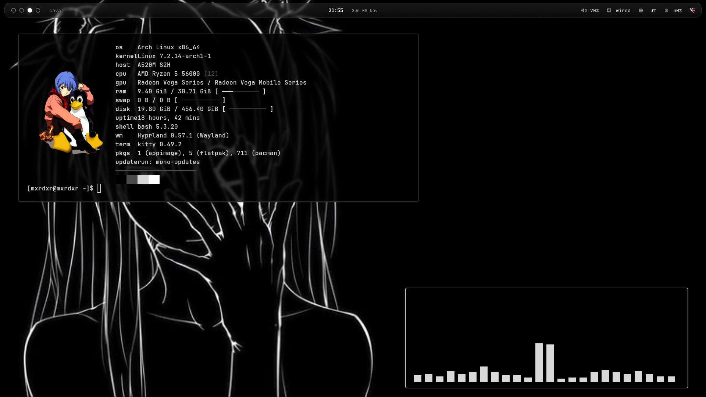
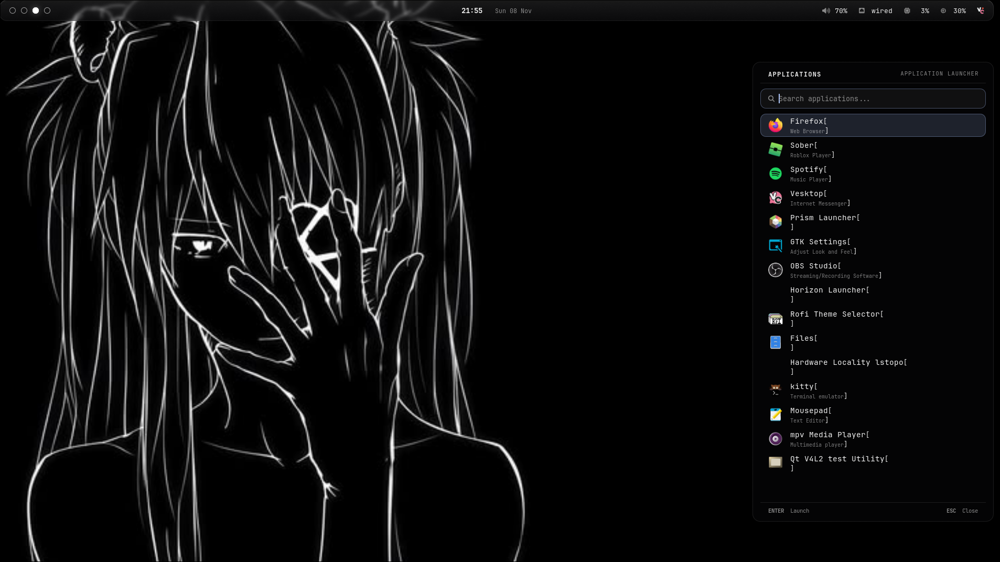

# Black Glass: Hyprland Rice

dark, minimal desktop setup built around Hyprland, with a monochrome look, blurred transparency, and a bit of glassy eye candy. Includes Waybar, Rofi, Mako, Kitty, wallpaper-based accent colors with matugen, and a matching SDDM login screen.

> **Made on Arch Linux.** The install steps use `pacman`. Other distros should work, but package names will prob be diffrent idk




## What i used

| Part | What it does | Location |
|------|--------------|----------|
| Hyprland | Window manager: 1px white border, rounded corners, blur, custom binds | `config/hypr` |
| Waybar | Floating glass top bar: workspaces, window title, clock, audio, network, CPU, RAM, tray | `config/waybar` |
| Rofi | Glass app launcher panel on the right edge | `config/rofi` |
| Mako | Glass notifications, top right | `config/mako` |
| Kitty | Transparent black-and-white terminal with a cursor trail | `config/kitty` |
| matugen | Generates Rofi, Mako and Kitty colors from your wallpaper | `config/matugen` |
| `retheme` | One command: pick a wallpaper, regenerate colors, repaint | `bin/retheme` |
| Wallpaper picker | Rofi grid of wallpaper previews (`SUPER + W`) | `config/hypr/scripts/wppicker.sh` |
| SDDM | `black-glass` login theme (Qt6) | `sddm/` |

## how to install

```bash
git clone https://github.com/cryjng000/black-glass-rice.git
cd black-glass-rice
./install.sh
```

script uses sudo 

you can add a wallpaper (check below) and js run retheme once log out and pick hyprland i mean you already know tho if you wanna do it manually just check below

## Manual install

### Install deps

```bash
sudo pacman -S --needed hyprland waybar rofi mako kitty dolphin \
  grim slurp wl-clipboard brightnessctl playerctl \
  pipewire pipewire-pulse wireplumber pavucontrol libnotify ffmpeg \
  ttf-jetbrains-mono-nerd ttf-nerd-fonts-symbols inter-font \
  sddm qt6-declarative matugen
```

- If `matugen` isnt in your repos install it from the AUR for example yay -S matugen-bin
- Your Hyprland version must support the lua config (.config/hypr/hyprland.lua)
- Fonts: **JetBrainsMono Nerd Font** (bar, launcher, notifications, terminal), **Symbols Nerd Font** (icons) and **Inter** (login screen).
- `ffmpeg` is for video wallpapers. `pavucontrol` opens when you click the volume module
- Optional extras: cava (audio visualizer) and `fastfetch` terminal greet

### 2. copy configs etc.

```bash
mkdir -p ~/.config ~/.local/bin ~/config-backup
for d in hypr waybar rofi mako kitty matugen; do
  [ -e ~/.config/$d ] && mv ~/.config/$d ~/config-backup/
done

cp -r config/hypr config/waybar config/rofi config/mako config/kitty config/matugen ~/.config/
chmod +x ~/.config/hypr/scripts/wppicker.sh
install -m 755 bin/* ~/.local/bin/
mkdir -p ~/.config/wallpapers
```

Make sure `~/.local/bin` is on your PATH. Waybar and Mako start automatically with Hyprland (see the `hyprland.start` block in `hyprland.lua`).

### 3. add wallpaper and generate colors

```bash
cp /path/to/your-wallpaper.jpg ~/.config/wallpapers/
retheme ~/.config/wallpapers/your-wallpaper.jpg
```
4. install sddm needs root check below for the wallpaper etc.

**Change the login wallpaper:** edit `background=` in `/usr/share/sddm/themes/black-glass/theme.conf`. Any image works. Other options there: `fontFamily`, `enableBlur`, `backgroundBlur`, `clock24h`.

### 5. Start it

Log out (or reboot), choose **Hyprland** in SDDM, and log in.

## Wallpapers and colors

wallpapers arent included so add your own to `~/.config/wallpapers/` (`jpg`, `png`, and `mp4`/`webm`/`mkv` videos). Then:

```bash
retheme                       # random wallpaper from the folder
retheme path/to/file          # a specific image or video
PREFER=darkness retheme file  # change how matugen picks the accent color
MODE=light retheme file       # light palette
```

you can press `SUPER + W` for a grid picker (`Ctrl + O` opens the folder).

`retheme` runs matugen on the wallpaper, which regenerates `rofi/colors.rasi`, `mako/config` and `kitty/matugen-colors.conf` from the templates in `config/matugen/templates/`. Edit the templates, not the generated files.

**the terminal stays black and white on purpose.** `kitty.conf` ends with `include mono.conf`, which overrides the wallpaper colors with a greyscale palette (`theme.conf`). Delete that line if you want Kitty to follow your wallpaper too.

## keybinds

`SUPER` is the main modifier. The keyboard layout is Turkish (`tr`); change `kb_layout` in `hyprland.lua` for yours.

| Keys | Action |
|------|--------|
| `SUPER + Q` | Terminal (Kitty) |
| `SUPER + C` | Close window |
| `SUPER + M` | Exit Hyprland |
| `SUPER + E` | File manager (Dolphin) |
| `SUPER + R` | App launcher (Rofi) |
| `SUPER + W` | Wallpaper picker |
| `SUPER + V` | Toggle floating |
| `SUPER + P` | Pseudo-tile |
| `SUPER + J` | Toggle split direction |
| `SUPER + Arrow keys` | Move focus |
| `SUPER + 1-0` | Go to workspace 1-10 |
| `SUPER + SHIFT + 1-0` | Move window to workspace |
| `SUPER + S` | Toggle scratchpad |
| `SUPER + SHIFT + S` | Send window to scratchpad |
| `SUPER + Scroll` | Cycle workspaces |
| `SUPER + Left/Right mouse drag` | Move / resize window |
| `SHIFT + Print` | Screenshot a region to the clipboard |
| 3-finger swipe | Switch workspace |

volume brightness and media keys work through `wpctl`, `brightnessctl` and `playerctl`.

reload stuff without logging out:

```bash
hyprctl reload          # Hyprland config
pkill waybar; waybar &  # Waybar
makoctl reload          # Mako
```

## credits

Built with [Hyprland](https://hypr.land), [Waybar](https://github.com/Alexays/Waybar), [Rofi](https://github.com/davatorium/rofi), [Mako](https://github.com/emersion/mako), [Kitty](https://sw.kovidgoyal.net/kitty/), [SDDM](https://github.com/sddm/sddm) and [matugen](https://github.com/InioX/matugen).
